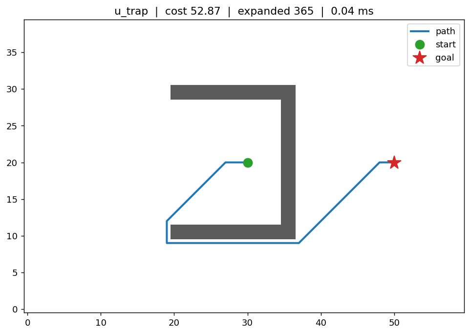
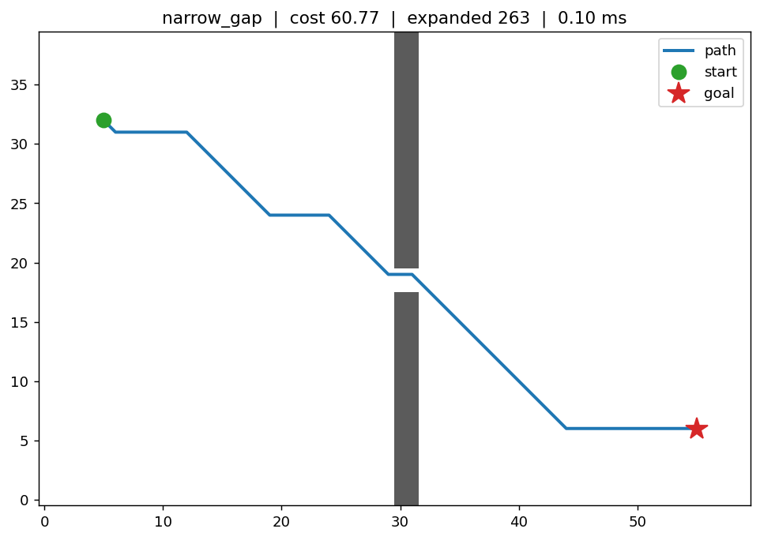
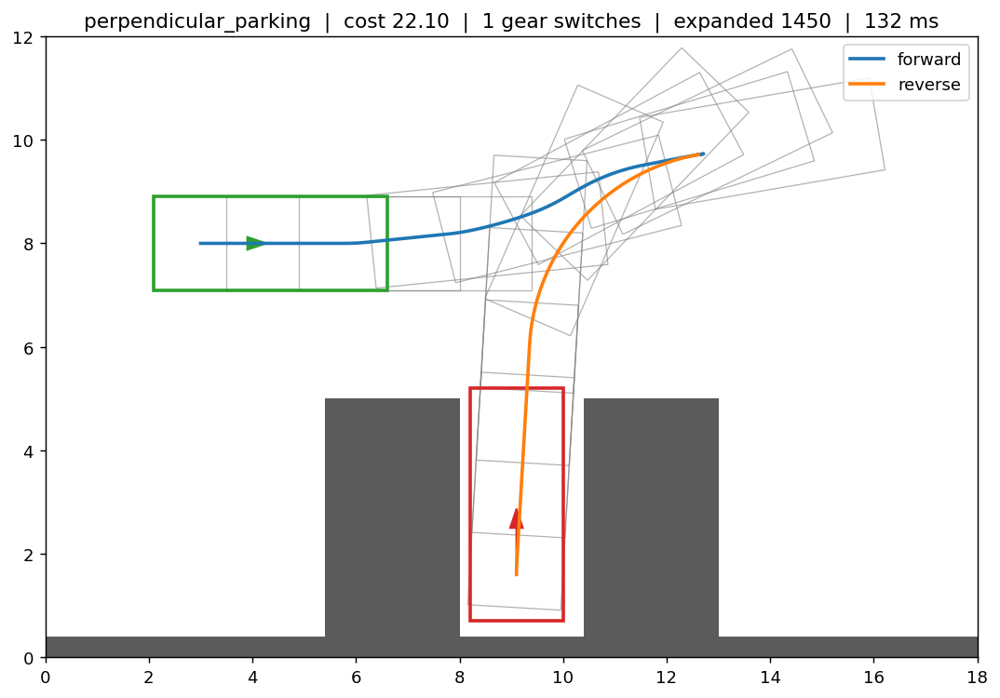
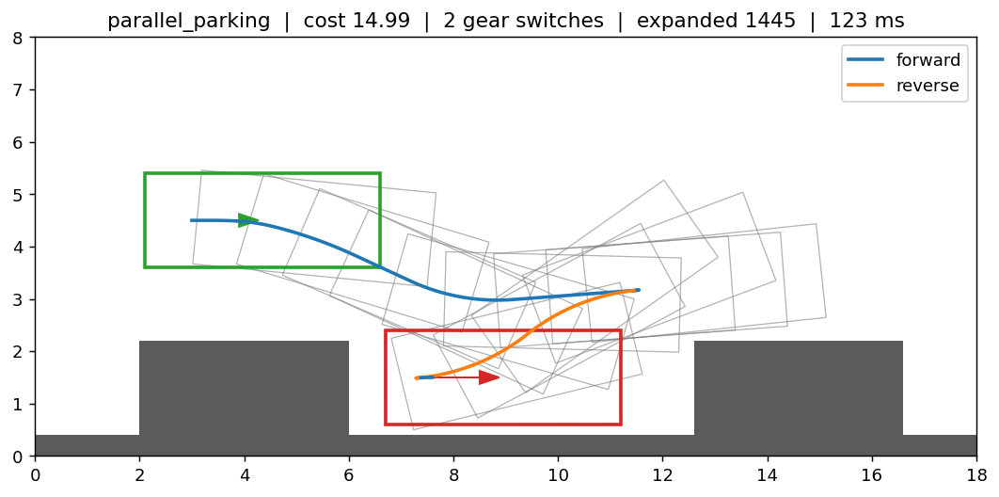

# motion-planning-cpp

[](https://github.com/stillsereneflow/motion-planning-cpp/actions/workflows/ci.yml)
[](LICENSE)

Motion planning algorithms for autonomous driving, implemented from first
principles in modern C++17. No framework dependencies — just the standard
library, GoogleTest for tests, and a small Python script for visualization.

[中文简介](#中文简介)

## Why this exists

Production autonomous-driving planners are built on a small set of core
algorithms. This repository implements them one by one, each with unit tests,
reproducible demo scenarios, and quantitative stats (path cost, nodes
expanded, runtime), so the behavior of every algorithm is visible and
verifiable — see [docs/DESIGN.md](docs/DESIGN.md) for the architecture.

## Algorithms

| Algorithm | Status | Notes |
| --- | --- | --- |
| A* (4/8-connected) | ✅ done | Octile/Manhattan heuristic, weighted mode, corner-cutting prevention |
| Reeds-Shepp curves | ✅ done | All word families with timeflip/reflect/backwards symmetries |
| Hybrid A* | ✅ done | Exact bicycle-model primitives, dual admissible heuristic, RS analytic expansion |
| RRT / RRT* | 🚧 planned (M3) | Goal biasing, rewiring, benchmarks against A* |
| Trajectory smoothing | 🚧 planned (M4) | Gradient smoothing + velocity profile under accel limits |

## Demo

Output of `plan_demo` (Release build, WSL2 on a laptop i7):

```
scenario        success        cost    expanded     time_ms
open_field          yes       66.67         151       0.043
u_trap              yes       52.87         365       0.043
narrow_gap          yes       60.77         263       0.100
```

| U-trap (escaping a local minimum) | Narrow gap |
| --- | --- |
|  |  |

### Parking with Hybrid A*

Output of `parking_demo` — kinematically feasible maneuvers for a 4.5 m car
with a ~3.95 m minimum turning radius, blue driven forward, orange in
reverse:

```
scenario                  success      cost     cusps    expanded     time_ms
perpendicular_parking         yes     22.10         1        1450       132.4
parallel_parking              yes     14.99         2        1445       123.3
```





## Build & run

Requires a C++17 compiler and CMake ≥ 3.20. GoogleTest is located via
`find_package` and fetched automatically when not installed.

```bash
cmake -S . -B build -DCMAKE_BUILD_TYPE=Release
cmake --build build --parallel
ctest --test-dir build --output-on-failure   # run the unit tests
./build/apps/plan_demo out                   # grid A* demo scenarios
./build/apps/parking_demo out                # Hybrid A* parking scenarios
python3 tools/visualize.py out/*.json --out-dir docs/images
```

## Project layout

```
include/mpl/   public headers (GridMap, planners)
src/           implementation
apps/          demo executables
tests/         GoogleTest unit tests
tools/         Python visualization
docs/          design doc + rendered images
```

## 中文简介

面向自动驾驶的运动规划算法库，使用现代 C++17 从零实现，核心库不依赖任何第三方框架。

目前已实现：A*（八连通/四连通、加权模式、禁止对角穿墙）、Reeds-Shepp 曲线（全部字族 + 三种对称变换，600 组随机位姿性质测试验证）、Hybrid A*（精确自行车模型运动基元、RS 距离与障碍距离场取大的双可采纳启发式、RS 解析扩展精确接入目标位姿），可完成垂直泊车与平行泊车等多次换挡机动。路线图还包括 RRT/RRT* 与轨迹平滑、速度规划。每个算法都配有单元测试和可复现的演示场景，输出路径代价、换挡次数、扩展节点数、耗时等量化指标；演示结果由 `tools/visualize.py` 渲染成上方图片。架构与路线图见[设计文档](docs/DESIGN.md)。

## License

[MIT](LICENSE)
